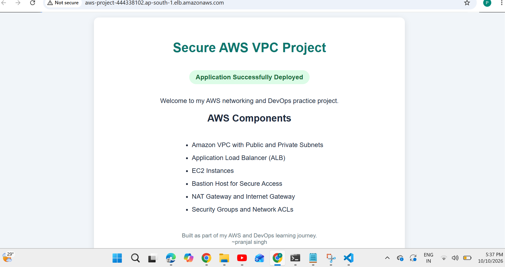
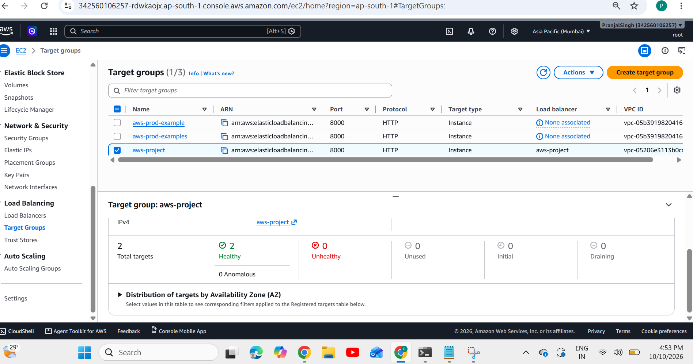

\# Secure AWS VPC Infrastructure with Application Load Balancer


\## Project Overview


This hands-on AWS project demonstrates how to build a network environment using a custom Virtual Private Cloud (VPC), public and private subnets, EC2 instances, a Bastion Host, and an Application Load Balancer (ALB).


The project focuses on network segmentation, controlled access to private instances, load balancing, and network security.


\## Architecture Diagram


```mermaid

flowchart TB

&#x20;   User\["Internet User"]

&#x20;   IGW\["Internet Gateway"]

&#x20;   subgraph VPC\["Custom AWS VPC"]

&#x20;       subgraph Public\["Public Subnets"]

&#x20;           ALB\["Application Load Balancer"]

&#x20;           Bastion\["Bastion / Jump Host"]

&#x20;       end

&#x20;       subgraph Private\["Private Subnets"]

&#x20;           TG\["Target Group"]

&#x20;           EC1\["Private EC2 Instance"]

&#x20;           EC2\["Additional EC2 Instance"]

&#x20;       end

&#x20;       SG\["Security Groups"]

&#x20;       NACL\["Network ACLs"]

&#x20;       NAT\["NAT Gateway"]

&#x20;   end


&#x20;   User --> IGW

&#x20;   IGW --> ALB

&#x20;   ALB --> TG

&#x20;   TG --> EC1

&#x20;   TG --> EC2

&#x20;   User -. "SSH via approved access path" .-> Bastion

&#x20;   Bastion -. "Private SSH access" .-> EC1

&#x20;   Bastion -. "Private SSH access" .-> EC2

&#x20;   Private -. "Outbound internet via route table" .-> NAT

&#x20;   NAT --> IGW

&#x20;   SG -. "Controls instance and ALB traffic" .-> EC1

&#x20;   NACL -. "Subnet-level traffic rules" .-> Private

```


> The diagram is a logical overview. Actual traffic paths depend on the configured route tables, ALB listeners, target registrations, and security rules. Only use the additional EC2 target if it is part of your actual setup.


\## AWS Components Used


\- \*\*Amazon VPC:\*\* Provides an isolated virtual network.

\- \*\*Public and Private Subnets:\*\* Separate public-facing resources from private workloads.

\- \*\*Internet Gateway:\*\* Enables internet connectivity for appropriately routed public resources.

\- \*\*EC2 Instances:\*\* Provide compute resources for the project.

\- \*\*Bastion / Jump Host:\*\* Provides an SSH access point for reaching private instances.

\- \*\*Application Load Balancer:\*\* Receives application traffic and forwards it to registered targets.

\- \*\*Target Group:\*\* Registers application targets. Target health was verified as `healthy`.

\- \*\*NAT Gateway:\*\* Supports outbound internet access for private resources when routing is configured.

\- \*\*Security Groups:\*\* Control allowed inbound and outbound traffic for associated resources.

\- \*\*Network ACLs:\*\* Apply subnet-level inbound and outbound traffic rules.


\## Security Design


\- Use a Bastion Host as a controlled entry point for SSH access to private instances.

\- Restrict SSH access to trusted source IP addresses.

\- Allow application traffic only from the intended sources.

\- Keep application instances in private subnets where appropriate.

\- Configure security groups, network ACLs, and route tables according to the required traffic flow.

\- Never upload AWS access keys, private SSH keys, passwords, or other credentials to GitHub.


\## Validation and Testing


The following checks are relevant to this project:


\- Confirm the VPC and subnet configuration.

\- Verify route table associations and internet routing.

\- Confirm the Bastion Host can reach the intended private EC2 instances.

\- Check ALB listeners and target group registrations.

\- Verify target health using AWS CLI.

\- Test the webpage through the ALB DNS name.

\- Review security group and network ACL rules.


\*\*Verified result:\*\* The target health check returned `healthy` for a registered EC2 target.


Complete each additional check before reporting it as successfully tested.


\## Tools and Technologies


\- Amazon Web Services (AWS)

\- Amazon VPC

\- Amazon EC2

\- Application Load Balancer

\- AWS CLI

\- Linux and SSH

\- Security Groups and Network ACLs

\- Git and GitHub

\- HTML


\## Key Learning Outcomes


\- Practiced AWS VPC networking and subnet segmentation.

\- Learned how a Bastion Host provides access to private EC2 instances.

\- Practiced application traffic routing through an ALB and Target Group.

\- Worked with AWS network security controls.

\- Used AWS CLI to inspect infrastructure and verify target health.


\## Project Status


Hands-on learning project. Configuration and testing details should reflect the resources currently deployed in AWS.


\## Author


\*\*Pranjal Singh\*\*


GitHub: \[@pranjalsingh84](https://github.com/pranjalsingh84)

## Project Screenshots

### Application Load Balancer Website



### Target Group Health Status




